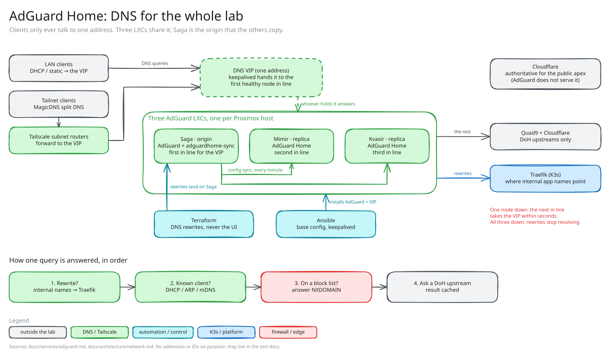

<!-- docs/services/adguard.md -->

# AdGuard Home (DNS)

*Sketch of how it fits together; editable source: [`adguard.excalidraw`](diagrams/adguard.excalidraw), see [`diagrams/README.md`](diagrams/README.md).*

Three LXCs (Saga / Mimir / Kvasir) run AdGuard Home as the homelab's resolver and ad/tracker blocker. One VIP, `10.0.10.200`, floats across them via keepalived; clients only ever talk to the VIP. Saga is the origin: `adguardhome-sync` runs on Saga and pushes its config to Mimir and Kvasir every minute. Fully IaC since the 5b.2 cutover (2026-05-25); cutover runbook: [`agh-cutover.md`](../procedures/archive/2026-05-25-agh-cutover.md).

## Architecture

| Layer | Stack | Notes |
|-------|-------|-------|
| Trio | 3 × LXC (Debian 13), VMIDs 1110/1111/1112 on Urd/Verd/Skuld | 1 vCPU / 512 MB / 4 GB each; DNS cache and the sqlite query log dominate. Dual-NIC. |
| eth0, VLAN 11 | DNS (53) and web UI (80), default gateway | Per-node `10.0.11.201/202/203`. |
| eth1, VLAN 10 | VRRP and the VIP | Per-node `10.0.10.201/202/203`; VIP `10.0.10.200/32`. Source-based policy routing for `10.0.10.0/24` makes replies leave via eth1 (UCG's stateful firewall drops wrong-source replies). |
| App | AdGuard Home, version pinned by `adguard_version` in the role defaults | Config schema version 34 (`adguard_schema_version`). |
| Sync | `bakito/adguardhome-sync` on Saga only, cron `*/1` | Skips DNS server config (per-node) and DHCP (UCG owns it). Binary `/usr/local/bin/adguardhome-sync`, config `/etc/adguardhome-sync.yaml`. |
| VIP | keepalived, VRID 51 (PG HAProxy VIP uses 61: spacing-by-10 convention) | All peers start BACKUP, priority Saga 100 / Mimir 90 / Kvasir 80, so simultaneous boot can't dual-MASTER. Track-script `systemctl is-active --quiet AdGuardHome.service`, weight -50, demotes a holder whose AGH is down. |
| Upstream | DoH only: `dns10.quad9.net`, `cloudflare-dns.com` | Bootstrap via Quad9 ECS-aware IPs (`9.9.9.10`, `149.112.112.10`, `2620:fe::10`, `2620:fe::fe:10`); AGH's own fallback is Cloudflare DoH, then `1.1.1.1`. |
| Retention | 90 days query log, 24 h statistics | Long history for "what was that device doing last month", short stats keep the dashboard fast. |
| Cache | 4 MiB | |

**Why three nodes.** DNS is the most load-bearing service: losing it breaks everything that resolves a hostname. VIP + keepalived fails over in seconds, and three nodes (not two) leave N+1 redundancy while one is in maintenance.

## Who owns what

| Data class | Spec lives in | Mechanism |
|------------|---------------|-----------|
| LXC existence, sizing, placement | `terraform/proxmox/asgard-lxcs/lxcs.tf` `locals.adguard_nodes` | Terraform |
| NetBox mirror | `terraform/netbox/vms.tf` (`saga`/`mimir`/`kvasir`) | Terraform |
| AGH base config (listen addrs, upstreams, retention, admin user, default filters) | `ansible/roles/adguard/` + `group_vars/adguard.yml` | Ansible |
| keepalived VIP, VRRP, track-script | `group_vars/adguard.yml` (generic `keepalived` role) | Ansible |
| **DNS rewrites** | `terraform/adguard/rewrites.tf` `locals.rewrites` | Terraform (provider writes to Saga; sync fans out). **Never edited in the UI**; a UI-added rewrite is outside the IaC spec. |
| Clients, user rules, extra filter subscriptions | Operator UI on Saga | Synced to replicas by adguardhome-sync |

Rewrites are grouped by zone in `rewrites.tf`: `niflheim` (internal-only, K8s-fronted names point at Traefik `10.0.20.10`), `midgard` (internal alias of public services, skipping the Cloudflare tunnel hop), and a few apex LAN bypasses pointing bare-LXC services at the LXC IP. Decision rows: "AGH rewrites — Terraform managed" in [`decisions.md`](../operations/decisions.md).

The admin user is `ghost`, not the role default `admin` (`adguard_admin_user` / `adguardhome_sync_admin_user` in `group_vars/adguard.yml`).

## Secrets

| Vault path | Field | Used by |
|------------|-------|---------|
| `secret/ansible/adguard/admin-password-hash` | `hash` | `adguard` role: bcrypt hash for the admin user in `AdGuardHome.yaml` |
| `secret/ansible/adguardhome-sync/admin-password` | `password` | `adguardhome-sync` role: HTTP basic-auth into origin and replicas (must match the bcrypt above) |
| `secret/ansible/keepalived/adguard_vrrp` | `auth_pass` | `keepalived` role: VRRP auth (max 8 chars) |

Human lookup and the Terraform provider: 1Password `[Asgard] - Terraform - AdGuard - Admin login` (via `homelab-env`; the provider authenticates with env, not Vault, because the AGH admin is operator-consumed). Rotation caveat: the role's idempotency guard no-ops a password rotation on an existing node ([`credential-rotation.md`](../procedures/credential-rotation.md)).

## Query flow

1. Clients are pointed (DHCP or static) at `10.0.10.200`; ARP resolves it to the current VIP holder (Saga, else Mimir, else Kvasir).
2. AGH answers, in order: a **rewrite** (e.g. `netbox.niflheim.xiiisins.com` → `10.0.20.10`); a known runtime client (DHCP/ARP/mDNS); **NXDOMAIN** if a filter list blocks it (`AdGuard DNS filter` on by default); otherwise a DoH upstream query.
3. The public apex `xiiisins.com` is not served by AGH; Cloudflare is authoritative. AGH answers `niflheim`, `midgard` and the few apex LAN bypasses.
4. Tailnet clients: MagicDNS split-resolves `niflheim` and `midgard` to the VIP (`terraform/tailscale/dns.tf`) via the subnet routers; the apex is deliberately not split.
5. **Never put a public resolver in a client's fallback chain**: they return NXDOMAIN for internal zones and glibc/CoreDNS cache it as authoritative ([`dns-adguard.md`](../known-issues/dns-adguard.md)).

## Recovery

- **One node down:** keepalived demotes it (track-script, or missing adverts if hard-down); the next-priority peer binds the VIP. ARP caches settle in under 30 s.
- **Saga down:** the same failover, but sync stops, so replicas freeze at last-good config. When Saga returns, its state overwrites anything edited on a replica meanwhile. To make a change stick during an outage, edit Saga's `AdGuardHome.yaml` (SSH or console), then start sync. Rewrites are safe: they're in Terraform.
- **All three down:** clients fall back to whatever they have configured, and internal rewrites stop resolving; K3s pods will likely flap.
- **Rebuild:** redeploy via Ansible (base config), `terraform apply` in `terraform/adguard/` (rewrites), then restore clients/filters from Saga's `/opt/AdGuardHome/AdGuardHome.yaml` (PBS snapshots the LXC).

## Operational notes

- AGH binds **port 80** on each node; to put other HTTP on these LXCs, narrow `adguard_web_bind_addresses` or change the port.
- The role masks `systemd-resolved` to free port 53. `/etc/resolv.conf` belongs to PVE (the LXC `dns {}` block), pointing at `127.0.0.1` plus Quad9 so DNS works whatever the VRRP state; Ansible does not manage it ("LXC `/etc/resolv.conf` ownership" in `decisions.md`).
- **Schema bumps:** set `adguard_force_overwrite_config: true` (one-shot) when bumping `adguard_version` past a schema-changing release; otherwise the role keeps the existing `AdGuardHome.yaml`.
- **DoH bootstrap:** if the Quad9 bootstrap IPs are unreachable, AGH starts but every query times out. Temporarily add a plain upstream (`1.1.1.1`) to `adguard_upstream_dns`.
- `adguardhome-sync`'s "Sync done" line with a sub-microsecond duration isn't trustworthy: diff `/control/rewrite/list` on origin vs replicas.
- Role READMEs: [`adguard`](../../ansible/roles/adguard/README.md), [`adguardhome-sync`](../../ansible/roles/adguardhome-sync/README.md). Gotchas: [`dns-adguard.md`](../known-issues/dns-adguard.md), [`haproxy-keepalived.md`](../known-issues/haproxy-keepalived.md) (shared VIP/VRRP pattern).

## Not done

- **DoH endpoint on the homelab** (Phase 5b.3): expose AGH on the cluster's wildcard cert so clients can do DoH-to-AGH, drop plain-DNS fallbacks and give mobile clients a trusted resolver over the tailnet.
- **DHCP** stays on the UCG-Ultra; AGH could serve it but would couple DNS and DHCP failure domains. Deferred.
- **Filter subscriptions** are UI-managed; they could move into the `adguard_filters` group var for IaC tracking.
