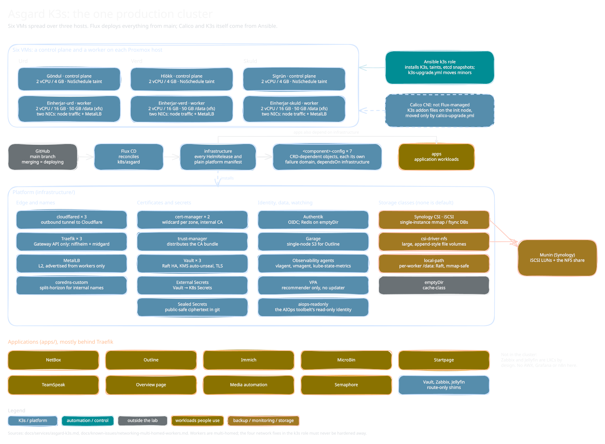

<!-- docs/services/asgard-k3s.md -->

# Asgard K3s cluster

*Sketch of how it fits together; editable source: [`asgard-k3s.excalidraw`](diagrams/asgard-k3s.excalidraw), see [`diagrams/README.md`](diagrams/README.md).*

The one production cluster (Jotunheim was dropped 2026-10-05; [`jotunheim-k3s.md`](jotunheim-k3s.md) is the shelved design). It runs the platform pieces whose absence cascades (Vault, ESO, MetalLB, Traefik, Authentik) and most application workloads. Resiliency over simplicity.

Status lives in [`build-sequence.md`](../operations/build-sequence.md); this page is the map of what runs and how it is wired. **Chart and image versions are not repeated here: the HelmRelease under `k8s/asgard/` is the pin** (all concrete, no floats), and `playbooks/platform-version-drift.yml` reports K3s/Calico drift.

## Nodes

| Name | VMID | Host | IP | Role | Spec |
|------|------|------|----|------|------|
| Göndul | 2001 | Urd | `10.0.21.11` | CP (default init node) | 2 vCPU / 4 GB / 20 GB |
| Hlökk | 2002 | Verd | `10.0.21.12` | CP | same |
| Sigrún | 2003 | Skuld | `10.0.21.13` | CP | same |
| Einherjar-urd | 2101 | Urd | `10.0.21.21` / `10.0.20.201` | worker | 2 vCPU / 16 GB / 30 GB `scsi0` + 50 GB `scsi1` (xfs `/data`, `local-path`) + 100 GB `scsi2` (xfs `/scratch`, `local-path-scratch`, not in PBS) |
| Einherjar-verd | 2102 | Verd | `10.0.21.22` / `10.0.20.202` | worker | same |
| Einherjar-skuld | 2103 | Skuld | `10.0.21.23` / `10.0.20.203` | worker | same |

- Authoritative specs: `locals.{control_planes,workers}` in `terraform/proxmox/asgard-k3s/main.tf`. CPs are identical by rule (failover symmetry; the 1 vCPU / 2 GB sizing could not carry the Authentik migrations). CPs carry the `control-plane:NoSchedule` taint (registration-time only; see [`k3s-lifecycle.md`](../known-issues/k3s-lifecycle.md)). Pod CIDR `10.42.0.0/16`, service CIDR `10.43.0.0/16`.
- **Workers are multi-homed:** eth0 VLAN 21 (node traffic), eth1 VLAN 20 (MetalLB L2). Four landmine fixes in `roles/k3s/tasks/network.yml` (Calico autodetection pinned to `10.0.21.0/24`, `rp_filter=2`, `route_localnet=1`, VLAN 20 source-based policy routing) must never be hardened away: [`networking-multi-homed-workers.md`](../known-issues/networking-multi-homed-workers.md).
- Worker kubelets reserve memory (`system-reserved` 1 Gi, `kube-reserved` 512 Mi, explicit `eviction-hard`) via `k3s_worker_kubelet_args` in `group_vars/k3s_worker.yml`.

## K3s install (Ansible `k3s` role, fully IaC)

- Task order: `prerequisites.yml` (k3s-selinux repo, iscsi-initiator, `br_netfilter`/`overlay`, `ip_forward`, swap off, firewalld off) → `network.yml` → `detect-state.yml` → `install.yml` → `calico.yml` (init node) → `config.yml` (always runs). `etcd-s3.yml` sets etcd snapshots to S3 ([`offsite-backups.md`](../procedures/offsite-backups.md)); `logging.yml` drops the etcd Raft-drop syslog flood; `taint.yml` applies the CP taint.
- `detect-state.yml` sets `k3s_already_healthy` (k3s active and node `Ready`); when true, install and Calico are skipped. That is why bumping `k3s_version` alone does nothing on a live cluster: minors go through `playbooks/k3s-upgrade.yml` ([procedure](../procedures/k3s-upgrade.md)), one per run.
- Bootstrap order: init node (`--cluster-init`) → joining CPs → workers, gated by node-count checks; token slurped from the init node; kubeconfig fetched to `~/.kube/niflheim-asgard.yaml`.
- Server config (`config-init`/`config-server`): disables bundled `traefik`, `servicelb` and `local-storage`, `flannel-backend: none`, `disable-network-policy`, explicit cluster/service CIDRs and TLS SANs, SELinux on. Workers get a minimal agent config.
- **Rebuilding the init node:** `-e k3s_init_node=hlokk` (any healthy CP) and `kubectl delete node <name>` from a survivor first.

## Calico (not Flux-managed)

Tigera operator + `Installation` are K3s **addon files on the init node**, laid down by `calico.yml` (first install only) and moved on a live cluster only by `playbooks/calico-upgrade.yml` (one minor per run, datastore export, CRD-prune guard). K3s prunes per addon file, which is how the 2026-10-01 datastore wipe happened: [incident](../incidents/2026-10-01-calico-datastore-prune.md). Desired version is `calico_version` in `roles/k3s/defaults/main.yml`.

Installation settings: node autodetection pinned to VLAN 21, `mtu: 1450` (workaround for projectcalico/calico#7851, the operator can't read `/var/lib/calico/mtu` under SELinux), `VXLANCrossSubnet`, `blockSize: 26`, `natOutgoing`. The addon controller *merges* the CR, so removed fields can persist; verify after changes.

## Flux structure

Flux pulls `k8s/asgard/` from `main` (merging is the deploy). Rule: anything that needs a CRD installed by a chart lives in its own `<component>-config/` Kustomization with `dependsOn: infrastructure`, so one component's failure domain can't block another's config (origin: an ESO webhook failure blocking MetalLB config, 2026-05-14).

| Kustomization | Contents | Depends on |
|---------------|----------|------------|
| `infrastructure` | Every HelmRelease and plain manifest under `infrastructure/` (below) | none |
| `infrastructure-config` | ESO `ClusterSecretStore` | infrastructure |
| `metallb-config` | `IPAddressPool` (`10.0.20.10–.99`), `L2Advertisement` (workers only) | infrastructure |
| `vault-config` | `vault-unseal` SealedSecret (a SealedSecret can't share a Kustomization with the chart that installs its CRD) | infrastructure |
| `synology-csi-config` | CSI client-info SealedSecret | infrastructure |
| `cert-manager-config` | ClusterIssuers (staging, prod, self-signed), the internal CA, Cloudflare ExternalSecret, trust bundle, Vault certificate | infrastructure |
| `gateway-config` | Gateways `niflheim` and `midgard`, wildcard certificates | infrastructure, cert-manager-config |
| `vpa-config` | One `VerticalPodAutoscaler` per Flux-managed workload (`updateMode: "Off"`) | infrastructure |
| `apps` | Application workloads (below) | infrastructure |

## Platform (`infrastructure/`)

| Component | Notes |
|-----------|-------|
| Sealed Secrets | Master key backed up to 1Password. Public-safe ciphertext in git. |
| Synology CSI | iSCSI for block-critical single-instance DBs only. **No default StorageClass:** every PVC names its tier or fails to bind (protects the DS223J LUN cap). [`synology.md`](synology.md) |
| csi-driver-nfs | Class `nfs-client`, Munin share, for large/append file-class volumes. |
| local-path-provisioner | Class `local-path` on each worker's `/data`: replicated state (Vault Raft) and mmap-safe single-instance. Class `local-path-scratch` (`Delete`) on `/scratch`: disposable bulk data, no PBS backup. One provisioner, two classes via `storageClassConfigs`. Replaces the disabled K3s built-in. |
| Vault | 3-node Raft HA on `local-path`, AWS KMS auto-unseal, TLS from the internal CA; UI at `vault.niflheim.xiiisins.com` via Authentik OIDC. Required pod anti-affinity: 3 replicas on 3 workers, so a cordoned worker leaves one Pending (2/3 voters is by design during a worker rebuild). Config in `terraform/vault/`. |
| External Secrets Operator | `ClusterSecretStore` `vault`, trusting the internal CA via `caProvider`. The validating webhook is `failurePolicy: Fail`, so Flux dry-runs of ExternalSecrets fail while its pod is being recreated. |
| MetalLB | L2, pool `10.0.20.10–.99`; `.10` is Traefik, `.11` the Vault UI. |
| Gateway API CRDs | Standard channel, vendored into `infrastructure/gateway-api/`. |
| cert-manager (2 replicas) | `enableGatewayAPI`, chart-installed CRDs kept. DNS-01 via Cloudflare with one zone-scoped token (`secret/k8s/cert-manager/cloudflare`). Issues one wildcard per zone (`niflheim`, `midgard`, apex) and the internal CA (`homelab-internal-ca`). |
| trust-manager | Distributes the internal CA bundle to ConfigMaps (needed by `BackendTLSPolicy` and ESO). |
| Traefik (3, one per worker) | Gateway API provider only, no Ingress/IngressRoute (`kubernetesCRD` on for Middleware). `externalTrafficPolicy: Local` + required anti-affinity for source-IP preservation; `maxSurge: 0` is mandatory (a surge pod can't schedule). LB `10.0.20.10`. Shared ForwardAuth middlewares are in `monitoring-namespace/` and the media app. |
| Authentik (server 3, worker 1) | Behind Traefik; external Postgres via the HAProxy VIP; blueprints and branding in git. Redis is a hand-rolled single-replica StatefulSet on `emptyDir` (cache-class; the 2026.x chart dropped its bundled Redis). |
| Cloudflared (3) | Locally-managed tunnel `asgard-k3s`; ingress rules point at Traefik's ClusterIP service, never a MetalLB VIP. Credentials via ESO. Public hosts: `authentik`, apex (WebFinger), `wiki`, `hugin`, `home`, `paste`, `immich`. |
| coredns-custom | In-cluster split-horizon: internal FQDNs served behind Traefik are rewritten to Traefik's ClusterIP name, because pod-to-MetalLB-VIP traffic trombones in L2 mode. |
| Observability agents | `monitoring` namespace, `victoria-logs-collector` (vlagent DaemonSet), kube-state-metrics, vmagent. Backends are in `apps/`. [`observability.md`](observability.md) |
| Garage | Single-node S3 (RF=1) for Outline; bucket/key provisioning in `terraform/garage/`. [`garage.md`](garage.md) |
| VPA | Recommender only (no updater, no admission webhook); objects in `vpa-config`. |
| aiops-readonly | The AIOps Toolbelt's read-only identity (ServiceAccount + ClusterRole without secrets/configmaps/exec/proxy). |

**Gateways.** `niflheim` (internal-only: `websecure` for `*.niflheim`; Traefik's entrypoint 301-redirects port 80) and `midgard` (listeners for `*.midgard`, `*.xiiisins.com` and bare `xiiisins.com`). Kept separate so public and internal route-attachment policies stay distinct. Zone scheme: [`network.md`](../architecture/network.md).

## Applications (`apps/`)

| App | Where it is documented |
|-----|------------------------|
| NetBox | [`netbox.md`](netbox.md) |
| Outline | [`outline.md`](outline.md) |
| Immich | [`immich.md`](immich.md) |
| VictoriaMetrics, VictoriaLogs (`monitoring`) | [`observability.md`](observability.md) |
| Semaphore (internal-only, Postgres via VIP, OIDC, NetBox dynamic inventory) | [`ansible-orchestration.md`](../architecture/ansible-orchestration.md) |
| Teamspeak | [`teamspeak.md`](teamspeak.md) |
| Startpage, MicroBin, apex-static (WebFinger) | [`startpage.md`](startpage.md), [`microbin.md`](microbin.md) |
| Overview page | [`overview.md`](overview.md) |
| Media automation (Sonarr, SABnzbd, Recyclarr) | [`media-automation.md`](media-automation.md) |
| `backups` (daily Vault Raft snapshot and Calico datastore export to S3) | [`offsite-backups.md`](../procedures/offsite-backups.md) |
| `vault-ingress`, `zabbix-ingress`, `jellyfin-ingress` | Route-only shims. Vault: HTTPRoute + `BackendTLSPolicy` to the in-cluster UI Service. Zabbix and Jellyfin: Service + EndpointSlice + HTTPRoute fronting the LXCs, which run outside K3s |

Not in the cluster: Zabbix ([`zabbix.md`](zabbix.md)) and Jellyfin ([`jellyfin.md`](jellyfin.md)) run on LXCs by design. There is no AWX, Tofu Controller, Grafana or n8n here (decisions: Semaphore, no Grafana; the AIOps n8n lives on Gná).

## Recovery fallback

A static recovery page on Munin (IPs, commands) that survives a full cluster outage is still an open item in [`open-questions.md`](../operations/open-questions.md).
