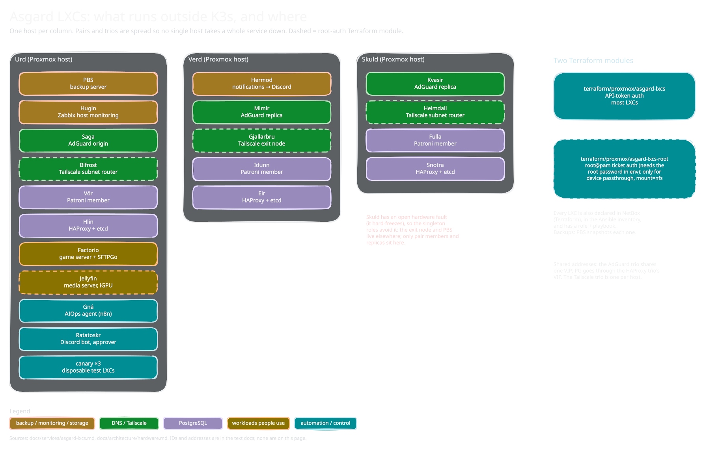

<!-- docs/services/asgard-lxcs.md -->

# Asgard LXCs

*Sketch of how it fits together; editable source: [`asgard-lxcs.excalidraw`](diagrams/asgard-lxcs.excalidraw), see [`diagrams/README.md`](diagrams/README.md).*

| LXC | ID | Node | IP | Role | Status |
|-----|----|------|----|------|--------|
| PBS | 1101 | Urd | `10.0.11.20` | Proxmox Backup Server (moved from Skuld 2026-10-01; the Munin NFS datastore is mounted inside the LXC) | ✅ |
| Zabbix (Hugin) | 1102 | Urd | `10.0.11.21` | Infrastructure monitoring (Zabbix 7.0 LTS) | ✅ |
| Hermod (Notifications) | 1103 | Verd | `10.0.11.22` | AppriseAPI aggregator → Discord (Phase 5h.2). Tag-driven routing (`critical`/`alert`/`media`); routine notifications stay in VL via vlagent. See [`notifications.md`](notifications.md). | ✅ |
| Saga (AdGuard 1) | 1110 | Urd | `10.0.11.201` | DNS primary | ✅ |
| Mimir (AdGuard 2) | 1111 | Verd | `10.0.11.202` | DNS replica | ✅ |
| Kvasir (AdGuard 3) | 1112 | Skuld | `10.0.11.203` | DNS replica | ✅ |
| Bifrost (Tailscale 1) | 1113 | Urd | `10.0.11.213` | Tailscale subnet router (advertises `10.0.0.0/16` supernet; auto-renewing key — Tailscale caps at 90d, see decision row + auth-key gotcha — `tag:subnet-router`). Primary of the bridge-pair. | ✅ |
| Heimdall (Tailscale 2) | 1114 | Skuld | `10.0.11.214` | Tailscale subnet router (same routes as Bifrost; auto-renewing key, `tag:subnet-router`). Guardian-of-the-bridge replica — naming-principle: primary defines theme, replica expands within it. | ✅ |
| Gjallarbru (Tailscale 3) | 1115 | Verd | `10.0.11.215` | Tailscale exit node (`--advertise-exit-node`; auto-renewing key, `tag:exit-node`). The bridge to Helheim — way out of the realm. | ✅ |
| Factorio | 1120 | Urd | `10.0.11.220` | Game server + SFTPGo | ✅ |
| Gná | 1121 | Urd | `10.0.11.221` | AIOps agent host: n8n diagnosis agent + Toolbelt client (Phase 10d). [`aiops-diagnosis.md`](../procedures/aiops-diagnosis.md) | ✅ |
| Ratatoskr | 1122 | Urd | `10.0.11.222` | AIOps Discord bot: chat transport and the only approver (Phase 10e). [`aiops-actions.md`](../procedures/aiops-actions.md) | ✅ |
| Jellyfin | 1123 | Urd | `10.0.11.223` | Media server, QuickSync on `/dev/dri/renderD128`, privileged, NFS media read-only from Munin. [`jellyfin.md`](jellyfin.md) | ✅ |
| Fulla (PostgreSQL 1) | 1130 | Skuld | `10.0.11.230` | Patroni PG member (PG 17 + TLS, cluster `niflheim-pg`) | ✅ |
| Vör (PostgreSQL 2) | 1131 | Urd | `10.0.11.231` | Patroni PG member | ✅ |
| Idunn (PostgreSQL 3) | 1132 | Verd | `10.0.11.232` | Patroni PG member | ✅ |
| HAProxy 1 (Hlin) | 1133 | Urd | `10.0.11.233` | HAProxy + etcd DCS (PG VIP `10.0.10.210`) | ✅ |
| HAProxy 2 (Eir) | 1134 | Verd | `10.0.11.234` | HAProxy + etcd DCS | ✅ |
| HAProxy 3 (Snotra) | 1135 | Skuld | `10.0.11.235` | HAProxy + etcd DCS | ✅ |
| canary-1/2/3 | 1190-1192 | Urd (only) | `10.0.11.190`-`.192` | AIOps canary pool (Phase 10b1): 512 MB baseline-only LXCs, disposable T1 fault-injection targets, converged by `site-nonprod.yml`, alerts capped at `info`. Fault injection must stay scoped to `canary-*` (Urd also hosts PBS/Hugin/K3s). [`canary-pool.md`](../procedures/canary-pool.md) | ✅ |

**AdGuard Home:** VIP at `10.0.10.200`. Sync via `adguardhome-sync` binary on Saga. ✅

**Terraform module split.** Most LXCs live in `terraform/proxmox/asgard-lxcs/` (single API-token provider). The Tailscale trio (1113/1114/1115) lives in `terraform/proxmox/asgard-lxcs-root/` (single root@pam provider, needs `PROXMOX_VE_PASSWORD` env) because `device_passthrough` for `/dev/net/tun` is one of the Proxmox API endpoints that only accepts ticket auth — see [`lxc-proxmox.md`](../known-issues/lxc-proxmox.md). The split keeps the main module API-token-only so most applies don't need an `op read` on every run; root-needing LXCs (today Tailscale and Jellyfin, future `fuse`/`keyctl`/additional passthroughs) join the `-root` module.

**Tailscale trio placement — singleton roles avoid the least-reliable node.** Gjallarbru (exit node) sits on **Verd**, Heimdall on **Skuld** — swapped 2026-07-21 (Gjallarbru had been on Skuld since 5e.3). Skuld carries an open hardware fault ([`../incidents/2026-07-17-skuld-hard-crashes.md`](../incidents/2026-07-17-skuld-hard-crashes.md)), and the exit node is a *single* advertiser: losing it drops every remote client's default route until it returns. The subnet routers are an *HA pair* — losing one is transparent to the tailnet, which reroutes via the survivor. So the role riding the unreliable node is a pair member, not the singleton. One Tailscale LXC per Proxmox host is preserved. Moved with `pct migrate --restart` + a Terraform state patch, not destroy/recreate — see [`../known-issues/terraform-state.md`](../known-issues/terraform-state.md) for why, and [decisions.md](../operations/decisions.md) for the general placement rule.
