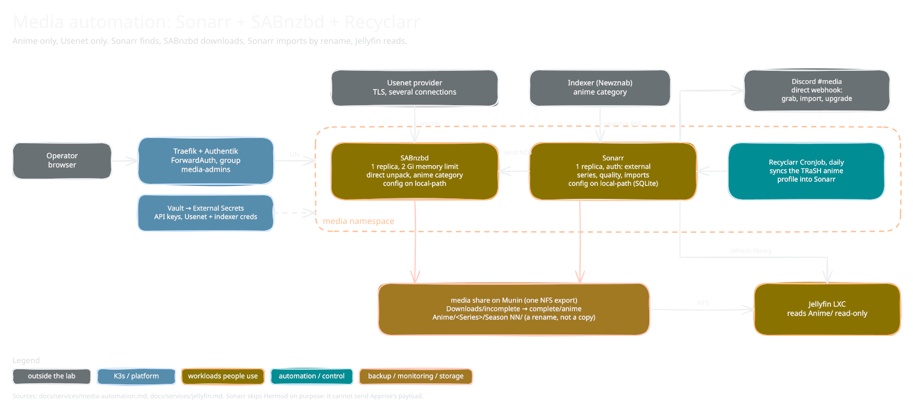

<!-- docs/services/media-automation.md -->

# Media automation: Sonarr + SABnzbd + Recyclarr (built 2026-10-08)

*Sketch of how it fits together; editable source: [`media-automation.excalidraw`](diagrams/media-automation.excalidraw), see [`diagrams/README.md`](diagrams/README.md).*

Anime only, Usenet only, no Radarr. Sonarr watches for episodes, SABnzbd downloads and unpacks them, and Sonarr imports the result into the library that Jellyfin ([`jellyfin.md`](jellyfin.md)) reads. Lives in asgard K3s as an ordinary app (`k8s/asgard/apps/media/`, namespace `media`, decision D-4 in [`5h-jellyfin.md`](../plans/active/5h-jellyfin.md)). Gotchas: [`known-issues/media-automation.md`](../known-issues/media-automation.md).

| Item | Value |
|---|---|
| Sonarr | `ghcr.io/linuxserver/sonarr` 4.0.20.3014-ls326, `Recreate`, 1 replica, `sonarr.niflheim.xiiisins.com`, auth method External (the Authentik ForwardAuth in front is the only login), API key seeded from Vault |
| SABnzbd | `ghcr.io/linuxserver/sabnzbd` 5.1.3-ls275, `Recreate`, 1 replica, CPU limit 1 core, memory 512 Mi request / **4 Gi limit** (page cache under NFS writeback counts against it), `sabnzbd.niflheim.xiiisins.com` |
| Recyclarr | `ghcr.io/recyclarr/recyclarr` 8.7.3, CronJob daily 04:30, syncs `k8s/asgard/apps/media/recyclarr-config.yaml` into Sonarr |
| Config volumes | local-path PVCs `sonarr-config` and `sabnzbd-config` (2 Gi each). SQLite and ini never on NFS |
| Scratch volume | PVC `sabnzbd-incomplete` (class `local-path-scratch`, the unbacked-up `/scratch` disk of the worker the pod runs on) at `/incomplete` in SABnzbd: jobs are assembled here. Pinned to that worker like `sabnzbd-config`; cache-class, a lost volume means re-downloading the jobs in flight. See [`../known-issues/storage-iscsi-synology.md`](../known-issues/storage-iscsi-synology.md) |
| Data volume | One static NFS PV `media-data` of `10.0.254.20:/volume5/media` (RWX, Retain) at `/data` in both pods: `/data/Downloads/complete/anime` (unpack target; finished jobs only) and `/data/Anime/<Series (Year) [tvdbid-N]>/Season NN/`. One export, so the import is a rename, not a copy |
| Jellyfin | The same share, mounted read-only at `/media`; the library `Anime` is `/media/Anime` (real-time monitoring off, Sonarr triggers refreshes) |
| Secrets | Vault `secret/k8s/media/sonarr` (`api_key`), `secret/k8s/media/sabnzbd` (`api_key`, `nzb_key`) minted by `terraform/vault`; `secret/k8s/media/usenet` (`host`, `port`, `username`, `password`, `connections`) and `secret/k8s/media/indexers/<name>` (`url`, `key`) seeded by hand; all mirrored to 1P ([`mirror-map.toml`](../../scripts/secrets/mirror-map.toml)) |
| Front door | HTTPRoutes on the niflheim Gateway behind the Authentik ForwardAuth middleware, group `media-admins` (`terraform/authentik/media.tf`). The two proxy providers must be attached to the embedded outpost once (Authentik UI), otherwise the browser loops on the login page. AGH rewrites in `terraform/adguard/rewrites.tf` |

## The DSM share

A dedicated shared folder `media` on volume5 (the old `media-backup` share, renamed after the backups moved off). NFS rules: the three workers `10.0.21.21-23` read/write and Jellyfin `10.0.11.223` read-only, all Squash **"Map all users to admin"**, so every file is created and read as the DSM `admin` account whatever uid the pod runs as and there is no uid or gid to keep in step. `Downloads` and `Anime` are mode 777 (DSM NFS decides by the POSIX mode bits, see [`known-issues/jellyfin.md`](../known-issues/jellyfin.md)). A `10.60.0/24` rule (No mapping, read/write) is the operator's own clients.

## SABnzbd configuration

`sabnzbd.ini` is rendered once by an init container (only when the file is missing): the seeded keys, host whitelist, `download_dir = /incomplete` (node-local scratch) and `complete_dir = /data/Downloads/complete` (NFS), direct unpack **off** (SABnzbd unpacks once the whole job is downloaded), `download_free = 10G` (pause rather than fill the scratch disk), `cleanup_list`, the `anime` category (and the default one) with `pp = 3` so SABnzbd repairs with par2 and unpacks, and the Usenet servers (FrugalUsenet primary on 563/SSL with the connection count from Vault, plus the `bonus.frugalusenet.com` backup server at priority 1 with 10 connections). After that the ini on the volume belongs to the UI, **except** the keys the init container re-asserts on every start so a manifest change takes effect: `cache_limit = 256M`, `bandwidth_max = 50M` (the link is shared with iSCSI and everything else on the workers), `download_dir`, `direct_unpack` and `download_free`. Throughput: with `incomplete/` on the NFS share SABnzbd held ~33 MB/s (about 265 Mbit/s of a 1 Gbit line) because the article writes, the direct unpack and the moves all went to the DS223J; with the downloads on scratch only the finished result is written to NFS. Delete the ini to re-seed everything.

## Sonarr configuration

- **As code:** Recyclarr syncs the TRaSH `[Anime] Remux-1080p` quality profile, its 57 custom formats, the anime quality sizes and the naming (`series: jellyfin-tvdb`, anime episode format with absolute number, release group and quality). Custom-format groups are the profile's defaults (minimum custom-format score 100).
- **Live in Sonarr's database (not in Git):** the SABnzbd download client (host `sabnzbd.media.svc.cluster.local:8080`, category `anime`), the root folder `/data/Anime`, the ameNZB indexer (Newznab, anime category 5070), the Jellyfin connection (`10.0.11.223:8096`, update library on import/upgrade/rename, path map `/data` to `/media`) and the Discord connection `Discord (media)`. A lost `sonarr-config` volume restores the profile and naming through Recyclarr; the rest is re-added through Sonarr's API from the Vault keys (the 2026-10-08 build did this with throw-away scripts; a repo-managed Job is an open question).
- **Notifications:** Sonarr cannot post Hermod/Apprise's payload, so its native Discord connection posts to the same media webhook Hermod uses for `tag: media` (Vault `ansible/hermod/discord/media`), as "Ölrún (Sonarr)", on grab, import, upgrade and manual interaction. It bypasses Hermod on purpose. See [`notifications.md`](notifications.md).

## Verified 2026-10-08

Series *Trapped in a Dating Sim: The World of Otome Games Is Tough for Mobs* (TVDB 412826, type Anime, S1 and S2, 24 episodes): search through ameNZB, download through SABnzbd over TLS (both servers test "Connection Successful"), import by rename, Jellyfin finds the episodes after a library refresh, and a real transcode through Jellyfin's API (720p, 2.5 Mbps) runs on `h264_qsv`. 23 of 24 episodes were imported at the time of writing, S1E7 in the queue. Not yet done: the Sonarr config-loss recovery test, tone-mapping/AV1/PGS playback on real files (the sources so far are 8-bit 1080p H.264), a Zabbix HTTP check on both UIs.
