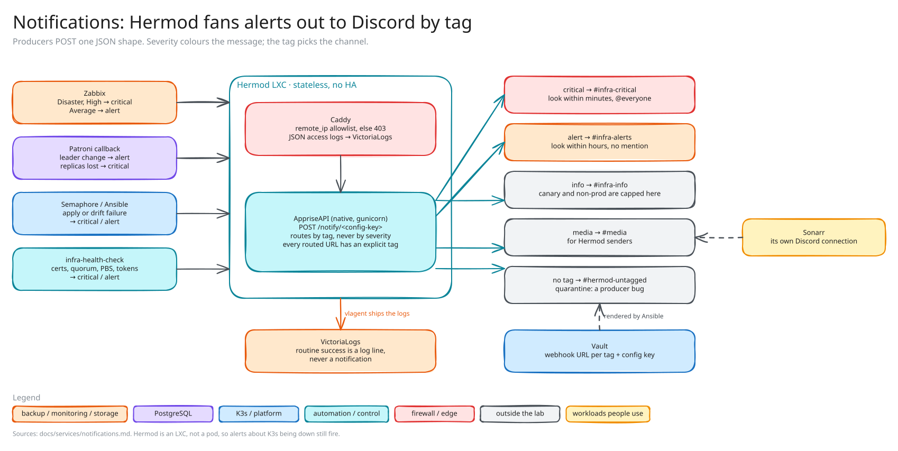

<!-- docs/services/notifications.md -->

# Notifications (Hermod, LXC 1103)



*Sketch of how it fits together; editable source: [`notifications.excalidraw`](diagrams/notifications.excalidraw), see [`diagrams/README.md`](diagrams/README.md).*

The homelab's single notification aggregation point. Sources POST to one HTTP endpoint; Hermod fans out to Discord webhooks (and any future channel) by tag. Wiring a new alert source needs no hub-side config. Built in Phase 5h.2 (2026-05-26); retros: [deploy](../incidents/2026-05-25-hermod-deploy.md), [producer wiring](../incidents/2026-05-26-hermod-producer-wiring.md).

## What it is

- **One LXC**, `hermod` (1103, `10.0.11.22`, Verd), Debian 13, unprivileged + nesting, 1 vCPU / 512 MB / 4 GB, VLAN 11. Ansible group is `apprise`; playbook `asgard-hermod.yml` (baseline, caddy-reverse-proxy, hermod-api, vlagent, zabbix-agent, hardening).
- **AppriseAPI** (80+ delivery backends), installed natively: pip into a venv, gunicorn (`bind 127.0.0.1:8000`), systemd, version pinned by `hermod_api_version`. No Docker, matching the "native + systemd" pattern of the other LXCs.
- **Caddy** on `:80` (generic `caddy-reverse-proxy` role) is the only listener. A `remote_ip` allowlist gates producers (non-matches get 403); JSON access logs at `/var/log/caddy/hermod.log` ship to VictoriaLogs via vlagent.
- **Stateless and internal-only:** config on the root disk (PBS-backed), no DB; reachable on VLAN 11 only, no Tailscale or Cloudflare. Endpoint: `http://hermod.niflheim.xiiisins.com/notify/<config-key>`.

## Why this shape

| Choice | Reason |
|--------|--------|
| LXC, not a K8s pod | Independent failure domain: alerts about K3s being down must fire when K3s is down. |
| AppriseAPI, not raw webhooks per source | One source-side schema, N destinations. Adding ntfy/email/Slack touches no source code. |
| Tag routing, not severity routing | Severity drives the embed *color*, the tag drives the *channel*. `tag: media` reuses the hub without sharing the infra channels. (Sonarr, the first media producer, can't send Apprise's payload and posts to the `#media` webhook through its own Discord connection; see [`media-automation.md`](media-automation.md).) |
| Routine events not routed via Hermod | vlagent already ships every host's logs to VictoriaLogs. A routine event is a log line. |
| Config on root disk, Ansible-managed | Like every other Ansible-managed service; PBS covers it. |
| Single LXC, no HA | If Hermod is down, notifications aren't delivered but producers' failures still log to VL. Revisit only if Discord becomes the sole channel and the downtime is felt. |

Out of scope: deduplication and storm prevention (the producer's job: Zabbix trigger dependencies, VMAlert `for:`), replay or querying (the audit trail is VL).

<!-- runbook: RB-ALERT-UNCLASSIFIED -->
## Severity taxonomy and routing

| Tag | Response expectation | Examples | Discord destination |
|-----|---------------------|----------|---------------------|
| `critical` | Look within minutes, even at 2am | Quorum lost, service hard-down, disk >90% | `#infra-critical`, `@everyone` |
| `alert` | Look within hours, business-day OK | Single-node failure (degraded but up), drift detected or correction failed, sustained load 5–15 min, disk 70–80% | `#infra-alerts`, no mention |
| `info` | FYI, never needs a response | Non-prod and canary-pool signals (`nonprod-*` wrappers, Zabbix events on `canary-*` hosts): the cap tier for anything that must never wake anyone | `#infra-info`, no mention |
| `media` | Whenever | Sonarr grab/import/upgrade, sent straight to the `#media` webhook, not through Hermod | `#media` |
| _(none, but POSTed)_ | Producer bug | Any POST without a `tag` | `#hermod-untagged` quarantine, no mention |
| _(routine success)_ | n/a | Clean drift-check, reconcile OK | Not sent; logged to VL |

Severity definitions come from response-time expectations, not impact adjectives: "service down at 2am" is `critical` because the *response time* differs from `alert`.

The quarantine exists because Apprise matches a tag-less notification against **every URL whose tag is unspecified**, so a stray POST would silently fan out wherever the YAML has tag-less URLs. The fix is structural: every routed URL has an explicit `tag:`, and exactly one URL (the quarantine webhook) has none.

## JSON schema (source → Hermod)

```json
POST /notify/<config-key>
{
  "title":  "required: headline, shown as the embed title",
  "body":   "required: message body (markdown if format=markdown)",
  "type":   "info | success | warning | failure",
  "tag":    "comma-separated routing key (critical, alert, info, media)",
  "format": "text | markdown | html"
}
```

`type` sets the embed **color** only (info blue, success green, warning yellow, failure red) and never routes. `tag` routes: Hermod delivers to every configured URL whose tag matches. `format` defaults to `text`.

## Apprise YAML (Hermod side)

Rendered by `roles/hermod-api` (`templates/apprise.yml.j2`) to `/etc/apprise/config/<config-key>.yml`; the config-key is a long random string (soft-auth in the URL, behind the Caddy allowlist). Each Discord webhook is stored in Vault as the **full webhook URL** in one `url` field (what Discord copy-pastes); the template strips `https://discord.com/api/webhooks/` and prepends `discord://`.

**The URL is the dict key, not a `url:` field.** A tagged route is `- discord://…/?format=markdown&username=Hrist:` with `- tag: critical` nested under it; the quarantine is a bare string entry with no options. The sibling-field form (`- url: …` + `tag: …`) silently fails with "Unsupported URL … no service(s) to notify".

Display names, forced via Apprise's `?username=` (so Discord shows them whatever the webhook is called there): **Hrist** `critical` (the shaker), **Mist** `alert` (cloud), **Randgrid** `info` (shield-truce), **Ölrún** `media` (ale-rune), **Hel** untagged (the underworld of lost messages). Adding a channel (e.g. ntfy push for `critical`) is one YAML line.

## Source-side severity mapping

The policy artifact: every producer maps its native severity to a tag. Changes here are policy decisions worth a PR; the Apprise YAML only realizes them.

| Producer | Native level | Tag |
|----------|-------------|-----|
| Zabbix | Disaster, High | `critical` |
| Zabbix | Average | `alert` |
| Zabbix | Disaster/High/Average on a `canary-*` host | `info` (capped in `hermod-webhook.js`) |
| Zabbix | Information, Warning | none (logged only) |
| VMAlert (future, Phase 8b) | critical / warning | `critical` / `alert` |
| Semaphore | apply failure / drift-check failure | `critical` / `alert` |
| Semaphore `asgard-nonprod-apply`, `-drift-check` | failure (changes-only drift is silent) | `info`, title prefixed `[non-prod]` |
| Semaphore | success | none |
| Patroni | leader change / all replicas lost | `alert` / `critical` |
| infra-health-check (S4 prober) | CF token invalid, cert <3d, Patroni/etcd quorum lost, PBS task failed or auth-fail, prober errored | `critical` |
| infra-health-check | cert <14d | `alert` |
| infra-health-check | all clean | none (debug line to VL) |
| Ansible custom playbook | `failed_when` trigger | author picks; documented in the role README |
| Sonarr / Radarr | releases | `media` (direct webhook) |

**Machine-readable form (Phase 10c).** The same producers, normalized into a versioned alert (`host`, `service`, `check`, `severity` = the tag, `runbook_id`, fingerprint, timestamps), live in [`aiops/`](../../aiops/README.md): schema, per-source mapping ([`alert-mapping.md`](../../aiops/alert-mapping.md)), and a routing table guaranteeing every `critical` path resolves to a `runbook_id`. Producers still POST the wire format above; a new producer or message shape needs a route in `aiops/alert-routing.yml`, until then it lands on `RB-ALERT-UNCLASSIFIED`.

## Producer wiring

- **Zabbix:** `roles/zabbix-server` declares a webhook media type (`templates/hermod-webhook.js`) via `community.zabbix.zabbix_mediatype` and attaches it to `Admin`, the recipient of the stock "Report problems to Zabbix administrators" action, so no action wiring is needed. The script maps severity → tag (above), suppresses lower severities, and POSTs to the Hermod URL built from `webhook_params` with the config-key resolved from Vault at template time. The user-media severity bitmask (56: Average+High+Disaster) suppresses a second time. A separate n8n media type feeds the AIOps analysis path independently ([`zabbix.md`](zabbix.md)).
- **Patroni `on_role_change`:** `/etc/patroni/hermod-callback.sh` (rendered by `roles/patroni/tasks/hermod-callback.yml`, mode 0500 `postgres`, gated by `patroni_hermod_enabled`). `primary`/`master` (both appear: Patroni renamed it, and cold start still emits `master`), `replica` and `standby_leader` all map uniformly to `alert`/`warning`. Demotion is the other half of every failover, and a quieter colour for it was easy to miss. A cold start therefore yields three messages and a failover two. The script always exits 0 so a Hermod outage can never block Patroni's supervisor loop; failures log to `/var/log/patroni-hermod.log`.
- **Semaphore / Ansible:** the `hermod_summary` callback and the playbook wrappers (`apply.yml`, `drift-check.yml`, `nonprod-*`) post the run summary; `infra-health-check.yml` posts per its table above.
- **Not wired:** a PBS failure hook (deferred, PBS-side) and VMAlert (Phase 8b).

## Vault layout

```
secret/ansible/hermod/discord/{critical,alert,info,media,untagged}   { url }
secret/ansible/hermod/config-key                                      { value }
```

Under `ansible/` because the Ansible role is the consumer. The Discord webhooks are minted in the Discord UI and written to Vault by the operator (no TF resource; 1P mirrors `Hermod - Discord webhook - <tag>`). `config-key` is TF-minted in `terraform/vault/` (`random_password`, length 32, no specials). `hermod-api` resolves every path in `hermod_api_discord_vault_paths` and **fails fast on a missing one**, so seed a new tag's secret before running the role; until a live run renders it, a POST for that tag matches no Apprise URL and is dropped.

## Access control: Caddy allowlist

Caddy renders `:80 { @allowed remote_ip … ; handle @allowed { reverse_proxy 127.0.0.1:8000 } ; handle { respond "forbidden" 403 } }` with JSON logs (roll 10 MB × 5). The list is `caddy_sites[].allowed_cidrs` in `ansible/inventory/group_vars/apprise.yml`; adding a producer is a group_vars edit plus a re-run.

| CIDR | Producer |
|------|----------|
| `10.0.11.21/32` | Hugin (Zabbix) |
| `10.0.11.230–.232/32` | PG trio (Patroni callbacks) |
| `10.0.11.233–.235/32` | HAProxy/etcd trio |
| `10.0.11.30/32` | Frigg (control node; the `ping-operator` relay) |
| `10.0.21.0/24` | K3s nodes |
| `10.0.20.0/24` | MetalLB pool (LB-mode producers) |
| `10.0.254.11–.13/32` | Proxmox hosts |

The allowlist is the primary gate; the config-key is depth behind it.

## Operator ping from an unattended Claude session

`scripts/notify/ping-operator "<title>" "<body>" [info|alert|critical]` posts to `/notify/<key>`, reading the key from Vault `secret/ansible/hermod/config-key` inside the process (never printed). From a non-allowlisted source (the Mac) Hermod answers 403, so it retries from Frigg over SSH with the key on stdin. Use `alert` for "I need you"; `info` is the FYI channel.

## Possible later

ntfy phone push for `critical` (one YAML line); an email digest of `alert`; VMAlert's `notifier.config` pointed at an Apprise URL (Phase 8b); `@here` instead of `@everyone` for `critical` (one Apprise URL parameter, `&mentions=`).
