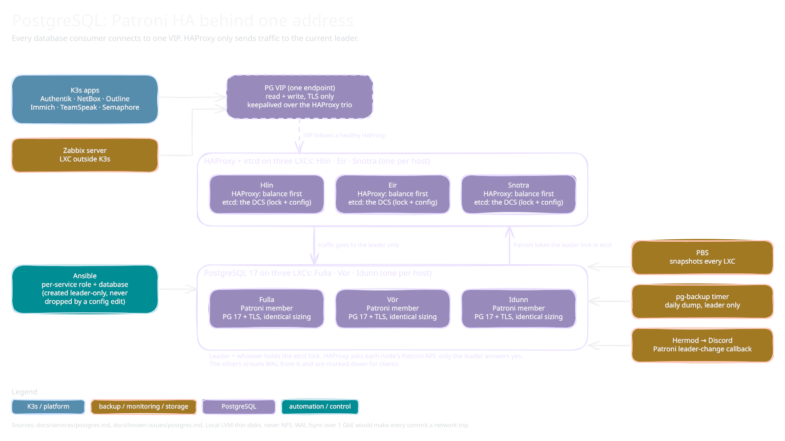

<!-- docs/services/postgres.md -->

# PostgreSQL (Patroni HA, Fulla / Vör / Idunn)

*Sketch of how it fits together; editable source: [`postgres.excalidraw`](diagrams/postgres.excalidraw), see [`diagrams/README.md`](diagrams/README.md).*

PostgreSQL 17 from PGDG on three LXCs: Fulla (1130, Skuld), Vör (1131, Urd) and Idunn (1132, Verd), TLS-enabled, scram-sha-256 only. Fulla was deployed standalone 2026-05-17; Phase 5g.2 (2026-05-24) adopted it in place into the Patroni cluster `niflheim-pg`, with Vör and Idunn joining as replicas (3/3 streaming); etcd DCS lives on the HAProxy/etcd LXC trio (Hlin/Eir/Snotra at 1133/1134/1135) — see [decisions](../operations/decisions.md) for the DCS-placement reasoning. Each cluster node lives on a different Proxmox host so a single-host failure never takes down >1 PG node.

**Why local LVM-thin, not NFS.** Postgres on NFS is an anti-pattern: Synology DSM's NFS isn't on anyone's validated list, fsync semantics vary between server implementations, soft mounts can silently drop writes under load, and WAL fsync over 1 GbE makes every commit a network round-trip. Database scale (the `postgres_databases` consumers: Authentik, NetBox, Zabbix, Teamspeak, Outline, Semaphore, Immich) is tens of GB fits inside the 16 GB LXC disk; `pct resize` is one command if it ever fills.

**Sizing (cluster-wide, identical across nodes).** 2 vCPU, 4 GB RAM, 16 GB disk. Failover symmetry requires identical resources — asymmetric sizing means failover silently degrades performance. Tuning: `shared_buffers=1GB` (25%), `effective_cache_size=3GB` (75%), `work_mem=16MB`, `maintenance_work_mem=256MB`, `max_connections=300` (bumped from 100 per 5g.2.a — cluster-wide demand from the seven consumers is ~150-200; pgbouncer skipped, see decisions), `wal_buffers=16MB`.

**TLS — self-signed, Ansible-managed.** 4096-bit RSA, 825-day cert. SAN covers `inventory_hostname`, `inventory_hostname.niflheim.xiiisins.com`, and the eth0 IP. `sslmode=require` is the practical client posture; `sslmode=verify-full` works once the cert ships to the client trust store. Long-term: cert-manager via ESO push to LXC.

**Authentication.**
- Local Unix socket: peer for `postgres` superuser (so `sudo -iu postgres psql` works without a password). scram-sha-256 for everything else.
- Network: `hostssl` only, scram-sha-256. Allowed source CIDRs in `postgres_allowed_cidrs`: VLAN 11 (asgard LXCs), VLAN 21 (asgard K3s nodes, via node NAT), VLAN 31 (Jotunheim, reserved but unused since Phase 7 was dropped), MacBook `/32`.
- Three management roles: `admin` (SUPERUSER, hand-on-keyboard), `ansible` (SUPERUSER, playbook runs + Patroni's internal superuser/rewind user), `replicator` (REPLICATION + LOGIN, Patroni-internal for streaming + `pg_basebackup`). Passwords from HashiCorp Vault via `community.hashi_vault` (`secret/ansible/postgres/{admin,ansible,replicator}-password`). The Unix-side `postgres` superuser has no password — peer auth only, no network logins.
- Patroni REST API basic-auth (`patroni_admin`, `secret/ansible/patroni/restapi-password`) — gates write operations (failover/switchover/reinit); reads (cluster status) are open.

**WAL / replication readiness from day 1.** `wal_level=replica`, `max_wal_senders=10`, `max_replication_slots=10`, `hot_standby=on`, `archive_mode=on` with `archive_command='/bin/true'` (no-op placeholder). All four are restart-required to change, so they're set right from the start — adding 1131/1132 later doesn't require a config thrash + restart. When real WAL archiving is wanted, flip `archive_command` to the actual destination.

**Per-service DB provisioning.** Driven declaratively by `postgres_databases` in `inventory/group_vars/postgres.yml`. Each entry: `{name, owner, password_vault_path}`. Role iterates: creates the owning role (LOGIN only — not SUPERUSER, scoped to its DB), creates the DB owned by that role using `template0` + explicit encoding/collation pinned to `baseline_locale`. New consumer = new group_var entry + re-run playbook. No role editing required.

**Database deletion is deliberately NOT declarative** — removing an entry from `postgres_databases` does NOT drop the DB. Drop is a deliberate manual operation (`psql -c 'DROP DATABASE x'`). Group_var typos must not be able to drop data.

**Backups.** Two layers. PBS captures each LXC filesystem (including the data dir; restore is "PG replays WAL on startup"). On top, the `pg-backup` role installs a daily logical-dump timer on every node; each self-skips unless it is the current Patroni leader (a long `pg_dump` on a hot standby gets cancelled by recovery conflicts), so the dump always lands on the leader and PBS captures it. Point-in-time recovery (WAL archiving plus `pg_basebackup` to Munin) is deferred, tracked in [`open-questions.md`](../operations/open-questions.md); `archive_command` stays a placeholder until then.

**How the cluster came to be.** Standalone first, clustered later, on purpose: Fulla validated the per-service DB provisioning against Authentik (the first consumer), then HA was pulled forward 2026-05-24 by Authentik's PG-DNS flapping (mitigated by a literal-IP stopgap; the structural fix is HA plus a VIP). Patroni adoption was in place: Fulla's data became the cluster's initial state and Vör and Idunn joined via Patroni's `pg_basebackup` path. Phase 5g.2 closed with the VIP live, Authentik cut over, and failover validated ([retro](../incidents/2026-05-24-5g2-haproxy-keepalived-vip.md)).

**HA endpoint — HAProxy VIP `10.0.10.210`.** Single endpoint for all consumers, read + write. HAProxy probes each PG node's Patroni REST API on `:8008/master`; only the current leader returns 200, replicas return 503 → marked DOWN. `balance first` + one-UP-at-a-time = deterministic routing to the leader. `on-marked-down: shutdown-sessions` forces clients to reconnect through the VIP on leader demotion (instead of long-lived sessions sticking to the deposed primary). VIP floats across the HAProxy/etcd trio (Hlin/Eir/Snotra) via keepalived on VLAN 10 — see [decisions](../operations/decisions.md) for dual-NIC + election + VRID rows. Failover RTO observed at ~10-30s (DCS lock TTL + Patroni promotion + HAProxy health-check cycle) with Authentik recovering automatically via connection pool retry.

**Patroni management.** Cluster lifecycle (`initdb` skip on adoption, replica basebackup, failover election, leader-only writes), `postgresql.conf`, and `pg_hba.conf` are all owned by Patroni now. The `postgres` Ansible role is Patroni-aware: in patroni-managed mode it stops at packages + TLS cert generation + replicator-user creation pre-adoption (on the existing primary), then hands off to the `patroni` role. Post-Patroni, the same role's `bootstrap.yml` task runs leader-only (gated by the `patroni_is_leader` fact from Patroni's REST API) for management-user upserts + per-service DB provisioning. Manual cluster ops via `patronictl -c /etc/patroni/patroni.yml {list,failover,switchover,restart}`. pg_hba includes explicit `host replication <user> 127.0.0.1/32` + `::1/128` entries (the `host all all 127.0.0.1` rule does NOT cover the `replication` pseudo-database) so pg_rewind's local divergence-check works during ungraceful-failover rejoins — `wal_log_hints=on` is the supporting GUC.

**LXC features.** Unprivileged, `nesting=true` (systemd 257 on Debian 13). 2 vCPU / 4 GB RAM / 16 GB disk on Skuld.
